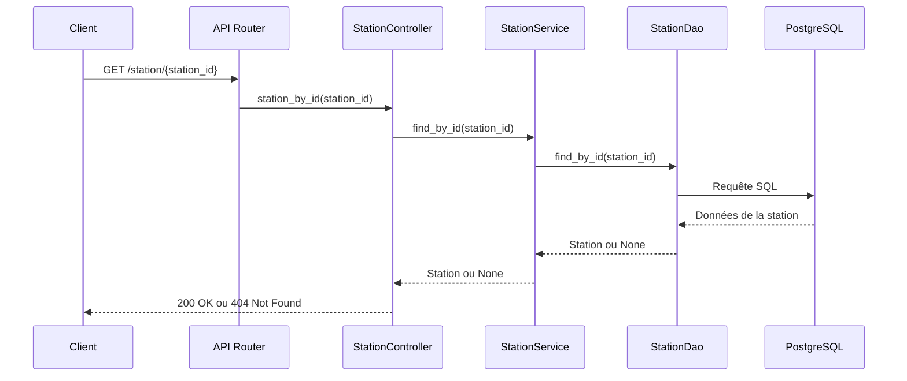

# Backend – VeloScope

Le backend constitue le cœur de l'application VeloScope. Il repose sur une API REST développée avec [FastAPI](https://fastapi.tiangolo.com/), organisée selon une architecture en couches. Il assure la gestion des stations, des comptes utilisateurs, des favoris, des indicateurs de fiabilité et des recommandations.

Il est également responsable de la collecte périodique des données du réseau de vélos en libre-service de Bordeaux, à partir de son API GBFS, et de leur stockage dans une base de données PostgreSQL.

## Lancer l'application

Les commandes suivantes sont à exécuter dans un terminal ouvert depuis la racine du dépôt.

- Installer les dépendances du backend :

```bash
uv sync --project backend --all-extras
```
  - L'option `--all-extras` permet également d'installer les dépendances de développement.

- Lancer le backend :

```bash
uv run --project backend python backend/src/main.py
```

L'API est alors accessible sur le port 5000 en environnement local.

**Documentation de l'API :**

- Swagger : `/docs`
- ReDoc : `/redoc`

**Configuration :**

Le backend nécessite des variables d'environnement pour se connecter à la base de données PostgreSQL. Elles permettent notamment de définir l'hôte, le port, le nom de la base, l'utilisateur, le mot de passe et le schéma utilisé.

La collecte automatique des données GBFS peut être activée ou désactivée au démarrage du backend (option o/n).

## Architecture

Le backend suit une **architecture en couches (Layered Architecture)** afin de séparer les responsabilités et de faciliter la maintenance et l'évolution du projet.

Les différentes couches sont organisées comme suit :

- **Business Objects** (`business_object/`) : représentent les objets métier de l'application, indépendamment des mécanismes de stockage et de communication.
- **Controllers** (`controller/`) : définissent les routes de l'API avec FastAPI, reçoivent les requêtes HTTP et transmettent les opérations aux services.
- **Services** (`service/`) : regroupent la logique métier et coordonnent les traitements nécessaires.
- **DAOs** (`dao/`) : assurent les interactions avec la base de données PostgreSQL (lecture, insertion, modification et suppression).
- **Schemas** (`schema/`) : définissent, à l'aide de [Pydantic](https://docs.pydantic.dev/), la structure et la validation des données échangées par l'API.

### Fonctionnement des couches

Exemple du parcours d'une requête permettant de consulter une station à partir de son identifiant :



### Collecte des données externes

La collecte des données GBFS est organisée indépendamment du fonctionnement classique de l'API. Elle repose sur une séparation entre la récupération des données brutes et leur adaptation au format métier attendu.

Les principaux composants sont :

- **Background Collection** (`background_collection`) : organise le lancement périodique de la collecte en arrière-plan.
- **Collection Service** (`service/`) : coordonne le traitement des données collectées et leur transmission à la couche DAO.
- **GBFS Provider** : coordonne les composants chargés de la collecte et de l'adaptation des données.
- **GBFS Client** : interroge l'API externe et récupère les données brutes au format JSON.
- **Adapter** : transforme les données reçues en objets métier compatibles avec l'application.

La collecte est réalisée de manière périodique et en arrière-plan afin de ne pas bloquer le fonctionnement principal de l'API.

## Base de données

Les données de l'application sont stockées dans une base PostgreSQL.

Elle contient notamment :
- Les informations générales des stations.
- Les relevés successifs de disponibilité des stations.
- Les comptes utilisateurs et leurs informations d'authentification.
- Les associations entre utilisateurs et stations favorites.

Les relevés de disponibilité sont conservés dans le temps afin de permettre le calcul des indicateurs de fiabilité et l'analyse de l'évolution de la disponibilité des stations.

## Outils de développement

### Journalisation et débogage

Le backend utilise un système de journalisation configuré dans `logging_config.yml`.

Les événements et les erreurs sont enregistrés dans le dossier `backend/logs/`. Un décorateur personnalisé `@log` permet également de journaliser automatiquement les appels de certaines méthodes, notamment leurs entrées et leurs sorties, afin de faciliter le suivi des traitements.

### Tests unitaires

Les tests permettent de vérifier le bon fonctionnement des différentes couches du backend, notamment les services et les DAO.

La configuration des tests est définie dans le `pyproject.toml` :
- Répertoire des tests : `backend/tests/`
- Fichiers de tests : `*test*.py`
- Exécution avec `pytest`.

Pour lancer l'ensemble des tests :

```bash
uv run --project backend pytest -v
```

Il est également possible de mesurer la couverture des tests avec [Coverage.py](https://coverage.readthedocs.io/).

```bash
# Exécuter les tests en mesurant leur couverture
uv run --project backend coverage run -m pytest backend

# Afficher le rapport de couverture dans le terminal
uv run --project backend coverage report -m

# Générer un rapport HTML
uv run --project backend coverage html
```

Le rapport détaillé est ensuite consultable dans `htmlcov/index.html`.

### Ruff

Le projet utilise [Ruff](https://docs.astral.sh/ruff/) pour maintenir un code Python homogène et détecter certaines erreurs.

Le formatage automatique à l'enregistrement est configuré dans les paramètres de l'espace de travail VS Code.

Les commandes suivantes permettent également de lancer les vérifications manuellement :

```bash
# Formater le code
uv run --project backend ruff format backend/

# Vérifier le code et corriger les erreurs automatiquement lorsque possible
uv run --project backend ruff check --fix backend/
