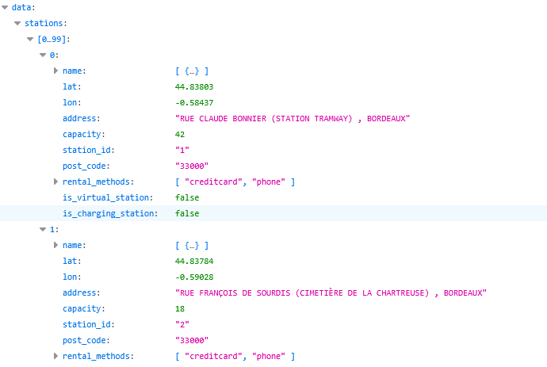
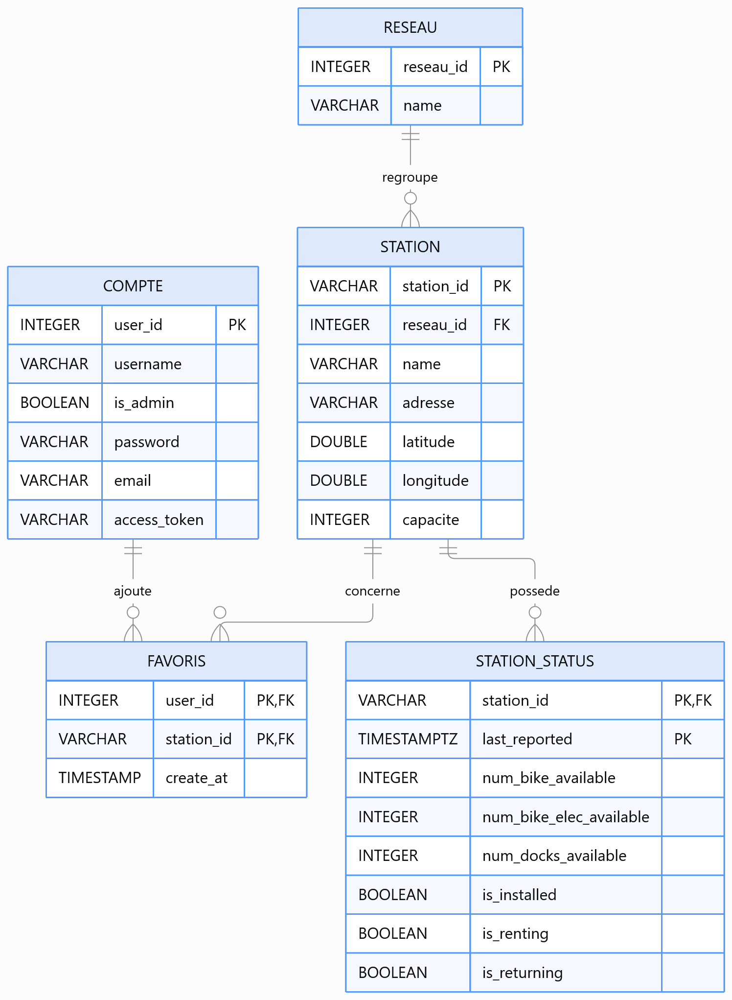
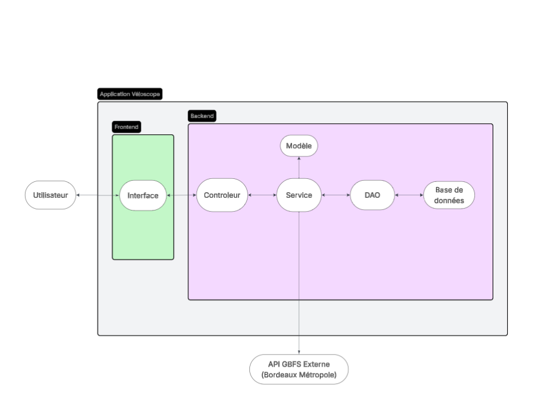
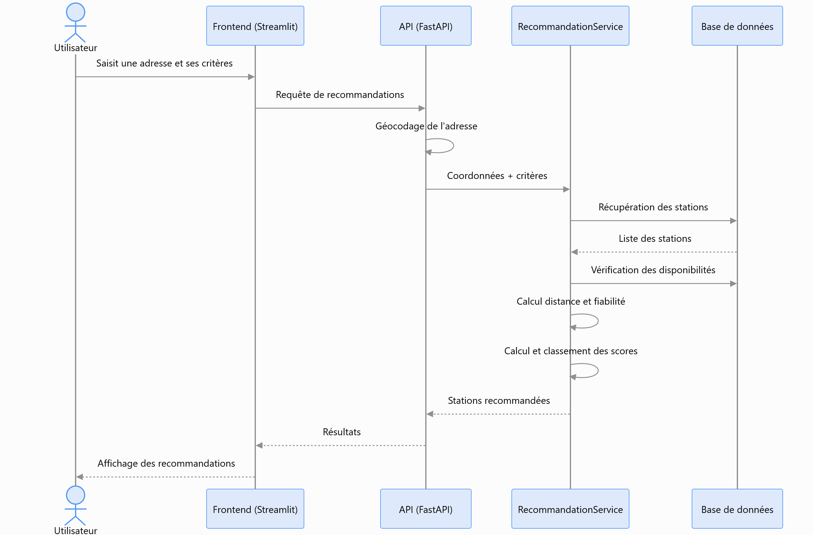
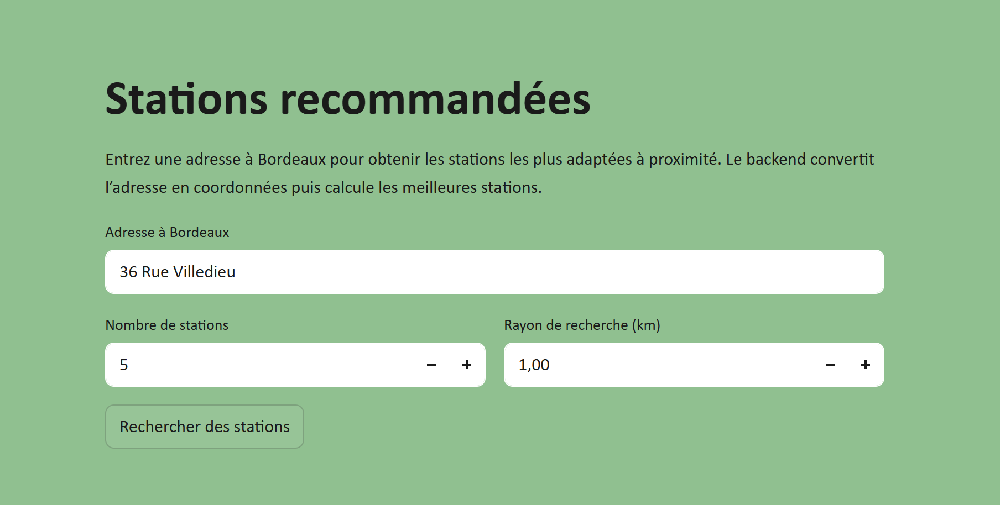
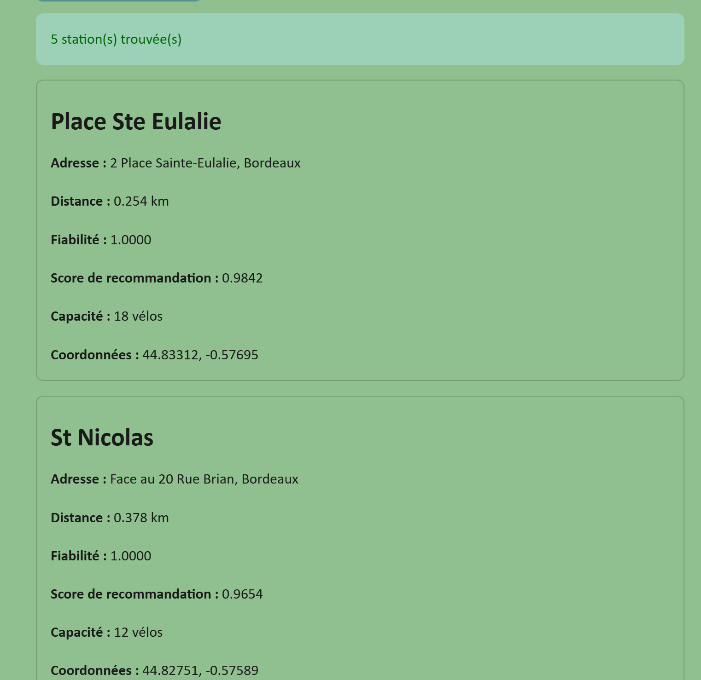
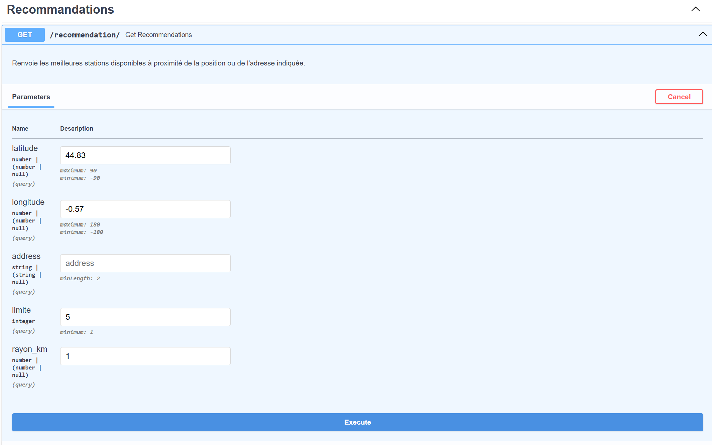
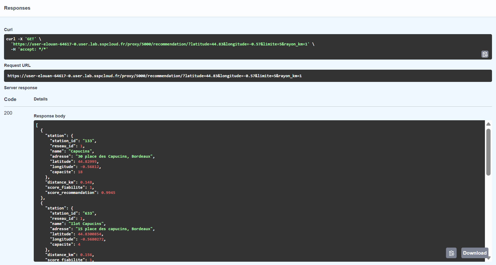

\begin{titlepage}
\raggedright

\includegraphics{../ressources/ensai_logo_2.png}\\

\centering
\vspace{0.5cm}
{\LARGE\textsc{Rapport de projet VeloScope}}\\
\vspace{0.5cm}

\vspace{1.5cm}

\rule{\textwidth}{0.5mm}\\
\vspace{0.8cm}
{\huge\bfseries VeloScope}\\
\vspace{0.8cm}
\rule{\textwidth}{0.5mm}\\

\vspace{1.5cm}

\begin{flushleft}
\emph{Étudiant·e·s :}\\
Fanny BOUBY\\
Audrey DANJOIE\\
Romane DELANZY\\
Jean POHARDY\\
Elouan REGUIGNE GRANCHER\\
\end{flushleft}

\begin{flushright}
\emph{Responsable :}\\
Ludovic DENEUVILLE\\
\vspace{0.5cm}
\emph{Tuteur :}\\
André RIVIERE\\
\end{flushright}

\vfill 
\begin{center}
École nationale de la statistique et de l’analyse de l’information\\
2026--2027
\end{center}
\end{titlepage}

\tableofcontents

\pagebreak

# Introduction
## Remise en contexte et problématique

Dans un contexte de transition écologique et de décongestion des centres urbains, l'encouragement à l'usage du vélo au quotidien est devenu une priorité majeure pour les collectivités. Les réseaux de vélos en libre-service jouent un rôle clé dans cette dynamique de mobilité douce. Aujourd'hui, la plupart des métropoles mettent à disposition des applications mobiles affichant une carte des stations en temps réel.
Son usage reste pourtant soumis à certaines incertitudes. Par exemple, on ne sait pas si l'on trouvera un vélo ou une place libre pour le rendre lorsqu'on arrivera à une station. Les réseaux publient la disponibilité à l’instant présent, mais cette information ne dit rien de la régularité d’une station : certaines sont fréquemment vides aux heures de pointe ou saturées le soir, d’autres sont presque toujours utilisables.

Comment dépasser la simple visualisation instantanée de l'état d'un réseau de vélos en libre-service pour fournir aux usagers des indicateurs historiques de fiabilité et des recommandations personnalisées fiables ?

L'application VeloScope est notre réponse à cette problématique. Contrairement aux applications classiques qui affichent l'état du réseau à la dernière date de relevé seulement, VeloScope construit sa propre mémoire. Notre application interroge périodiquement les serveurs de données publiques de la ville de Bordeaux (VLS Le Vélo TBM Bordeaux Métropole) et historise chaque relevé dans une base de données. En analysant cet historique, VeloScope calcule des indicateurs de performance (taux de pénurie, taux de saturation, score de fiabilité) et propose un moteur de recommandation multicritère aidant l'usager à choisir la station la plus pertinente.

Sera décrit dans ce rapport le nécessaire pour connaître le fonctionnement de l'application : fonctionnalités, données utilisées, architecture de l'application, rapport de tests qualité. Nous détaillons en particulier la fonctionnalité principale de recommandation de stations dans la partie "Réponse aux besoins". 

## A qui s'adresse l'application ?

VeloScope s'adresse à deux profils d'utilisateurs distincts et structurés selon un principe d'héritage des droits afin de simplifier l'usage quotidien :

* **L'Usager du réseau** (Utilisateur standard) : Il représente tout citoyen, étudiant ou travailleur souhaitant optimiser ses déplacements à vélo en ville. Après avoir créé son compte personnel et s'être connecté, il peut rechercher une station, visualiser l'évolution de sa disponibilité sur différentes périodes (24h, 7 jours, 30 jours), consulter son score de fiabilité, enregistrer ses stations habituelles en favoris, explorer la carte interactive du réseau ou demander une recommandation de station et d'itinéraire. Une liste de toutes les stations de vélo de la ville de Bordeaux lui est également disponible.

* **L'Administrateur** : Il s'agit du gestionnaire technique de la plateforme. Il dispose exactement des mêmes fonctionnalités qu'un usager standard (il n'a donc pas besoin de jongler entre deux comptes distincts pour utiliser l'application), mais bénéficie en plus d'un espace d'administration lui permettant de superviser les comptes inscrits. Il peut ainsi accéder à la liste de tous les utilisateurs, modifier les informations d'un compte si nécessaire (nom d'utilisateur, email, mot de passe, droits administrateur), ou supprimer un compte. Ce profil s'adresse principalement aux techniciens de maintenance et développeurs, dans le cas par exemple où un utilisateur aurait oublié son mot de passe. Notons que nous n'avons volontairement pas donné de droits sur la base de données à l'administrateur afin de préserver son intégrité. La gestion de cette base est faite automatiquement grâce au système de collecte présent en arrière plan de manière permanente dans notre application.

\pagebreak

# Présentation générale

## Organisation du groupe et gestion du projet

Pour mener à bien ce projet sur une durée de trois mois (de septembre à novembre 2026),nous devions à la fois répartir les différentes tâches dans le temps et entre les membres du groupe. Notre équipe de cinq étudiants a adopté l'organisation suivante. . 

Pour ce faire, nous avons, dès le début du projet organisé les grandes phases de notre travail dans le temps grâce au diagramme de Gantt ci-dessous. Il nous a permis de découper le projet en 2 temps.  Une première phase de conception en septembre dont les objectifs principaux étaient: la compréhension du sujet, la recherche de bases de données, la réflexion sur la structure de l'application et les réalisations des différents graphiques. La deuxième phase a débuté après le rendu du rapport intermédiaire. Elle était centrée sur la construction progressive et incrémentable de l'application via l'écriture du code.

&nbsp;&nbsp;&nbsp;&nbsp;&nbsp;&nbsp;&nbsp;&nbsp;

D'autre part, nous avons essayé de nous réunir assez régulièrement pour nous répartir les différentes tâches et faire le point sur ce qui avait été fait. La répartition des tâches s'est faite de manière à ce que chaque membre puisse toucher à un élément de chaque couche de l'application. Ainsi, chaque membre a participé à coder au moins un business object, un DAO, un controller et un service. Nous avons essayé de tenir compte au mieux des atouts et des préférences de chacun dans la répartition des tâches. 

Ainsi, les élèves ayant davantage de facilités en informatique se sont concentrés sur le code des classes les plus complexes (authentification/gestion des comptes, collecte depuis l'API externe, recommandation de station et calcul de fiabilité). 

Chaque semaine jusqu'à 3 jours de code intensif était consacrée au code d'une couche de l'application, dans l'ordre suivant : business object, DAO, services, controller. Nous testions l'intégralité des classes de chaque couche avant de passer à la suivante afin de ne pas rencontrer de problème lors du raccordement final. 

L'ensemble du code a été versionné sur un dépôt GitHub commun garantissant ainsi la cohérence et la qualité du code produit. 

## Fonctionnalités de l'API et besoins couverts

Le sujet imposait de construire une API qui collecte, historise et analyse les données d’un réseau de vélos en libre-service. Nous l’avons complétée par un site web interactif pour l'utilisateur avec Streamlit, qui est le point d’accès des utilisateurs : ils y créent un compte, se connectent, consultent les stations et demandent des recommandations, sans appeler l’API directement.

Cinq fonctionnalités obligatoires ont été implémentées. Elles sont détaillées ci-dessous.

* **F1 : Gestion des utilisateurs.** Un utilisateur peut créer un compte, se connecter et gérer ses stations favorites (ajout, suppression ou consultation de favoris). Un compte administrateur peut en plus gérer les comptes des autres utilisateurs. Chaque requête protégée est identifiée par un jeton transmis dans l’en-tête X-Auth-Token, et un champ is_admin porté par le compte distingue les deux profils.

* **F2 : Collecte des données.** L’API GBFS du réseau de Bordeaux n’expose que l’état présent des stations. Un script de collecte, pouvant être déclenché ou non (sur choix de l'utilisateur) lors du lancement de notre application, l’interroge toutes les 1h. À chaque passage, il met à jour la liste des stations (nom, adresse, coordonnées, capacité), puis enregistre un nouveau relevé de statut par station s'il n'a pas déjà été enregistré lors d'une précédente collecte : vélos disponibles (dont électriques), places libres, station installée, emprunt et retour autorisés. Chaque relevé est ajouté sans écraser les précédents, ce qui permet de reconstruire l’état du réseau à n’importe quel instant passé.

* **F3 : Consultation d'une station.** L’utilisateur recherche une station par son nom et consulte son état (disponible, vide, saturée ou non opérationnelle), son nombre de vélos et de places disponibles, sa capacité et son taux de remplissage (part des places occupées). Il peut visualiser l’évolution de sa disponibilité sur les dernières 24 heures, les 7 derniers jours ou les 30 derniers jours.

* **F4 : Score de fiabilité.** Pour chaque station, l’application calcule à partir de l’historique de ses statuts le pourcentage de temps passé vide et saturée, la durée moyenne des périodes de vide et de saturation, et un score global de fiabilité tenant compte de ces critères compris entre 0 et 1. 

Pour une station donnée, on note :
\begin{itemize}
  \item $T$ la durée totale de l'historique (en heures) ;
  \item $p_v$ la part du temps passée vide, c'est-à-dire
        la somme des durées des périodes de vide divisée par $T$ ;
  \item $p_s$ la part du temps passée saturée, c'est-à-dire
        la somme des durées des périodes de saturation divisée par $T$ ;
  \item $\bar{d}_v$ la durée moyenne, en heures, des épisodes de vide;
  \item $\bar{d}_s$ la durée moyenne, en heures, des épisodes de saturation;
  \item $c \in \{0, 1\}$ l'état actuel : $c = 1$ si la station n'est ni vide ni saturée,
        $c = 0$ sinon.
\end{itemize}

Le score de fiabilité $S \in [0, 1]$ est la moyenne de cinq composantes :
\begin{equation}
  S = \frac{1}{5}\left[\, c + (1 - p_v) + (1 - p_s)
      + \left(1 - \frac{\bar{d}_v}{T}\right)
      + \left(1 - \frac{\bar{d}_s}{T}\right) \right]
\end{equation}

L’évolution du score dans le temps est également disponible. Il est calculé pour chaque date disponible dans l'historique de la base de donnée depuis la date la plus ancienne de l'historique. 

* **F5 : Recommandation de station.** L’utilisateur saisit une adresse à Bordeaux, le nombre maximum de stations souhaité à recommander ainsi qu'un rayon de recherche. L’application convertit l’adresse en coordonnées, écarte les stations qui ne sont pas utilisables à la date du relevé le plus récent (non installée, emprunt impossible, aucun vélo disponible), puis classe les autres selon un score de recommandation égal à 

\begin{equation}
  S = 0,5 \times \textrm{proximité} + 0,5 \times \textrm{fiabilité}
\end{equation}

Le score de proximité décroît avec la distance, et la fiabilité est le score décrit dans F4. Deux stations à distance équivalente ne sont donc pas classées de la même façon si leur score de fiabilité diffère. Le nombre de vélos électriques disponibles et la tendance récente (fiabilité que jusqu'à une certaine date par ex.), cités dans le sujet comme critères possibles, ne sont pas pris en compte dans le classement. Leur prise en compte pourrait être une source d'amélioration de ce score. 

## Les données de l'application

L'application VéloScope s'appuie sur des données ouvertes pour fonctionner. Nous avons choisi d'utiliser celles fournies par la métropole de Bordeaux concernant son réseau de vélos en libre-service (TBM). C'était pour nous la base de données la plus complète compte-tenu des fonctionnalités que nous avions à développer, ayant un nombre raisonnable de stations (232). Son détail est disponible à l'adresse : https://bdx.mecatran.com/utw/ws/gbfs/bordeaux/v3/gbfs.json?apiKey=opendata-bordeaux-metropole-flux-gtfs-rt 

Les données externes sont récupérées via Internet au format JSON. C'est un format texte léger et structuré très répandu pour l'échange de données entre serveurs. Les données sur les systèmes de vélo en libre service sont stockées selon le standard international GBFS (General Bikeshare Feed Specification). 

Ce standard sépare les informations en deux flux bien distincts :

- Les données statiques (station_information) : Elles décrivent l'infrastructure fixe du réseau, qui change très rarement. On y trouve l'identifiant unique de chaque station, son nom, son adresse postale, sa capacité totale et ses coordonnées géographiques (latitude et longitude au format décimal WGS84).

- Les données dynamiques (station_status) : Elles reflètent l'activité du réseau en temps réel. Ce fichier contient, pour chaque identifiant de station, l'horodatage de la dernière mise à jour, le nombre de vélos mécaniques disponibles, le nombre de vélos à assistance électrique disponibles, le nombre de bornes libres, ainsi que des indicateurs booléens précisant si la station est ouverte, si l'on peut y louer un vélo et si l'on peut y en déposer un.

Certaines des données présentes dans l'API externe n'ont pas été collectées, comme la méthode de rente pour chaque station, car elles n'ont pas été jugées utiles à la réponse aux besoins.

| Nom de la variable | Type | Description |
|:------------------|:------------------|:------------------|
| `station_id` | VARCHAR(50) | Identifiant unique de la station. |
| `reseau_id` | INTEGER | Identifiant du réseau auquel appartient la station. |
| `name` | VARCHAR(150) | Nom de la station. |
| `adresse` | VARCHAR(255) | Adresse géographique de la station. |
| `latitude` | DOUBLE PRECISION | Latitude de la station sur la Terre. |
| `longitude` | DOUBLE PRECISION | Longitude de la station sur la Terre. |
| `capacite` | INTEGER | Nombre maximal de vélos que la station peut accueillir. |
| `last_reported` | TIMESTAMPTZ | Date et heure du relevé de disponibilité. |
| `num_bike_available` | INTEGER | Nombre total de vélos disponibles à la station au moment du relevé. |
| `num_bike_elec_available` | INTEGER | Nombre de vélos électriques disponibles à la station au moment du relevé. |
| `num_docks_available` | INTEGER | Nombre de places disponibles pour déposer un vélo au moment du relevé. |
| `is_installed` | BOOLEAN | Indique si la station est installée. |
| `is_renting` | BOOLEAN | Indique si la station permet actuellement d'emprunter des vélos. |
| `is_returning` | BOOLEAN | Indique si la station permet actuellement de rendre des vélos. |

Ces données sont par la suite stockées et mises à jour à l'aide d'une collecte automatique toute les heures sur notre service PostgreSQL. Par sécurité supplémentaire, les services PostGreSQL Onyxia pouvant être fermés, nous mettons à jour à chaque collecte le fichier `pop_db.sql` dans le dossier data contenant notre base SQL sous forme de requêtes. Il peut aussi servir pour le reset de la base de données (qu'il faut utiliser avec parcimonie).

Le détail de la base finale de travail sous forme de schéma est proposé ci-dessous.

&nbsp;&nbsp;&nbsp;&nbsp;&nbsp;&nbsp;&nbsp;&nbsp;

Notre modèle de données est composé de 5 tables. La table Compte gère les informations relatives aux utilisateurs. Station contient toutes les stations de la ville de Bordeaux. Station Statut possède l'ensemble des relevés de statuts de chaque station issus de la collecte. Réseau liste la liste des villes de notre réseau de vélo. Favoris gère les favoris de chaque utilisateur.

&nbsp;&nbsp;&nbsp;&nbsp;&nbsp;&nbsp;&nbsp;&nbsp;

Pour l'instant, notre réseau n'est composé que de celui de Bordeaux (id 1), mais il est possible d'ajouter d'autres villes. Notre table Compte est 3NF, les informations ne dépendant que de l'identifiant. Il en va de même pour la table station. La clé primaire de station_statut est le couple (station_id, last_reported) : on enregistre le statut d'une station à une date et heure donnée. Chaque favori est associé à un identifiant utilisateur (user_id, station_id). 

Il est à noter que certaines difficultés ont été rencontrées en confrontant notre application aux données réelles de Bordeaux sur plusieurs semaines.Parmi ces dernières, nous avons identifié plusieurs particularités nécessitant un nettoyage préalable :

- Stations en maintenance ou hors service : Certains relevés indiquent une station comme ouverte (is_renting = true), alors que la somme des vélos disponibles et des places libres est strictement inférieure à la capacité officielle de la station (bornes défectueuses ou vélos bloqués).

- Données figées ou absences de réponse : Il arrive ponctuellement que l'API de la ville renvoie des données obsolètes (horodatage last_reported inchangé pendant plusieurs heures) ou subisse une micro-coupure réseau. 

Notre module de collecte a été conçu pour filtrer les doublons temporels et ignorer les relevés incohérents afin de ne pas fausser nos calculs statistiques. Ce pré-traitement est notamment effectué au sein du DAO des stations.

L'ensemble des calculs concernant la fiabilité ne sont pas stockés dans notre base de données mais effectués à la volée. 

\pagebreak

# Architecture 

## Nature de l'application et choix technologiques

Véloscope est une application avec un client et un serveur qui communiquent via requête http. Notre objectif principal était de créer une application fiable et facile à faire évoluer. Ainsi, nous avons fait le choix de la découper en plusieurs briques et d'utiliser les outils cités ci-dessous. 

Notre projet utilise entièrement le langage de programmation Python connu pour sa clarté et sa puissance quant à l'analyse de données. Nous avons choisi FastAPI comme framework Python pour mettre à disposition les fonctionnalités du backend sous forme d'API REST. Elle réalise les calculs, gère la sécurité et communique avec la base de données. ELle est connue pour être rapide et génère automatiquement une documentation claire de toutes ses commandes. 

Les dépendances du frontend et du backend sont gérées par le gestionnaire de projets, de dépendances et d'environnements `uv`.Le frontend est crée grâce à Streamlit. Il s'agit d'un framework Python open source permettant de créer rapidement des applications web interactives

Notre base de données est stockée grace au logiciel spécialisé PostgreSQL. Il est sécurisé et permet le stockage d'une grande quantité d'informations. Ainsi, il conserve l'historique des relevés des stations vélo de Bordeaux. 

## Schéma d'architecture et décomposition en couche 

Notre application est organisée en cinq couches qui communiquent entre elles de manière ordonnée, permettant de séparer les différentes responsabilités du programme et de faciliter sa maintenance et son évolution. Le backend contient la logique de gestion des données, et le Frontend permet à l’utilisateur d’intéragir avec l’application. L’application communique également avec une source de données externe afin de récupérer les informations sur des stations de vélo.

La première couche, la seule visible par l'utilisateur est l'Interface (Streamlit). Il s'agit du Frontend. Il est la vitrine de notre application. L'interface affiche les différentes pages et permet à l'utilisateur d'intéragir avec l'application. Elle ne fait aucun calcul complexe elle même. Elle transmet seulement les instructions au Backend via requêtes HTTP. 

Les quatre autres couches forment le Backend. 

La deuxième couche est celle des contrôleurs (Controller Layer), développés avec FastAPI. Ils reçoivent les requêtes HTTP provenant du frontend, s'assurent que les paramètres nécessaires sont correctement transmis et font appel aux services correspondants. FastAPI prend également en charge une partie de la validation des données reçues.

La troisième couche est celle des services (Service Layer). Elle constitue le cœur de l'application et rassemble l'essentiel de la logique métier. On y retrouve les méthodes permettant le fonctionnement de VeloScope : calcul du score de fiabilité, génération des recommandations, vérification des mots de passe, gestion des favoris, etc. C'est également à ce niveau qu'est organisée la collecte des données provenant de l'API GBFS de Bordeaux Métropole, en s'appuyant sur des composants dédiés à leur récupération et à leur transformation.

La quatrième couche du projet est constituée des modèles. Il s'agit de classes représentant les entités manipulées par l'application sous forme d'objets Python. Ils permettent aux autres couches de fonctionner, notamment les services, sans avoir à connaître directement la structure des données provenant de PostgreSQL ou de l'API GBFS.

Enfin, la derniere couche est constituée des DAO. Les DAO assurent les interactions avec la base de données PostgreSQL. Ils permettent notamment de lire, d'insérer, de modifier et de supprimer les données, en isolant les opérations d'accès à la base du reste de la logique métier.

Ci-dessous un détail du diagramme de classe de notre application.

[diagramme de classe]

Notons que nous avons fait le choix de séparer les classes de service concernant les stations, la recommandation et la fiabilité en trois classes distinctes, bien que la recommandation et la fiabilité soient basées sur les détails des stations et de leurs statuts. Ce choix est avant tout fait par soucis de lisibilité du code (les services recommandation et fiabilité étant conséquents), mais également pour distinguer les responsabilités qui concernent la lecture de la basée de données de celles concernant la logique métier de l'application (calculs, valeur ajoutée).

\pagebreak

# Réponse aux besoins 

## Détails de la fonctionnalité F5 : Recommandation de station 

Nous détaillons dans cette partie la fonctionnalité F5 : Recommandation d'une station. Il s'agit de la fonctionnalité principale de notre application. Un utilisateur peut ainsi fournir une adresse de Bordeaux, par exemple "Place Pey Berland", choisir le nombre maximal de stations qu'il veut avoir en recommandation et le périmètre de recherche (rayon en km ayant pour centre l'adresse indiquée). L'application lui renvoie les stations recommandées selon le meilleur compromis compte tenu de la distance et de la fiabilité. Le diagramme de séquence de cette fonctionnalité est proposé ci-contre.

&nbsp;&nbsp;&nbsp;&nbsp;&nbsp;&nbsp;&nbsp;&nbsp;

&nbsp;&nbsp;&nbsp;&nbsp;&nbsp;&nbsp;&nbsp;&nbsp;

Zoomons sur ce processus de manière plus précise. 

&nbsp;&nbsp;&nbsp;&nbsp;&nbsp;&nbsp;&nbsp;&nbsp;

1) Recherche à partir d’une adresse

Partons de la page `recommendation`du frontend. Dans l’interface, une zone de saisie est créee afin que l’usager saisisse une adresse à Bordeaux et choisisse le nombre maximal de résultats ainsi qu’un rayon de recherche. L'utilisateur clique sur le bouton "Rechercher des stations". À ce moment, la requête HTTP est envoyée au backend.

&nbsp;&nbsp;&nbsp;&nbsp;&nbsp;&nbsp;&nbsp;&nbsp;

{#fig-reco-form}
&nbsp;&nbsp;&nbsp;&nbsp;&nbsp;&nbsp;&nbsp;&nbsp;

2) Traitement de la requête : conversion de l'adresse 

Le routeur FastAPI dans le controller `recommendation` reçoit cette requête. Cette fonction se charge de vérifier que l'on dispose d'une position, puis délègue le travail au service de recommandation. Pour vérifier que l'utilisateur a transmis une position avec son adresse et la convertir en coordonnées, on utilise le géocodage.

Pour ce faire, le controller appelle la fonction *geocode_bordeaux_address* dans utils. Cette fonction interroge **Nominatim**, le service de géocodage d’OpenStreetMap, grâce au package python `requests`. Il ajoute « Bordeaux, France » à l’adresse saisie, demande un résultat au format JSON et fixe un délai maximal de réponse de dix secondes. Les coordonnées retournées sont ensuite vérifiées : elles doivent se situer dans une zone géographique approximative autour de Bordeaux. Ce contrôle permet de rejeter les résultats manifestement éloignés, sans correspondre exactement aux limites administratives de la métropole. Une exception HTTP est levée en cas d'erreur.

L’API peut également recevoir directement une latitude et une longitude, sans passer par le géocodage (mais cela n'est pas disponible sur l'interface Streamlit). Dans les deux cas, le service de recommandation travaille finalement à partir de coordonnées.

&nbsp;&nbsp;&nbsp;&nbsp;&nbsp;&nbsp;&nbsp;&nbsp;

3) Sélection des stations et calcul du score

Le service récupère la liste de toutes les stations par appel au DAO et calcule la distance à vol d’oiseau entre la position recherchée et chaque station. Il utilise ensuite le dernier statut enregistré pour écarter les stations qui ne sont pas installées, qui ne permettent pas l’emprunt ou qui ne disposent d’aucun vélo, comme elles ne constituent pas une bonne recommandation. Pour les stations qui ne sont pas écartées, on calcule le score de fiabilité global par appel au service `fiabilite`. 

Le paramètre `rayon_km` permet de limiter la recherche aux stations situées dans un rayon donné. Il est facultatif dans l’API : sans ce paramètre, aucune distance maximale n’est appliquée. Le paramètre `limite`, égal à 5 par défaut, détermine le nombre maximal de résultats renvoyés.

Les stations qui satisfont ces critères sont classées selon un score combinant à parts égales la proximité et la fiabilité :

$$
S_{\mathrm{recommandation}}
= 0{,}5 \times S_{\mathrm{proximité}}
+ 0{,}5 \times S_{\mathrm{fiabilité}}
$$
Le score de proximité décroît avec la distance selon une fonction gaussienne :

$$
S_{\mathrm{proximité}} = e^{-\frac{d^2}{2\sigma^2}},
\qquad \sigma = 1\ \mathrm{km}
$$

où d désigne la distance entre l’adresse recherchée et la station. Le score de fiabilité est calculé à partir de l’état actuel de la station et de son historique : les proportions de temps passé vide ou saturée ainsi que la durée moyenne des épisodes correspondants. Il est renvoyé sous la forme d’une valeur comprise entre 0 et 1.

La décroissance gaussienne favorise nettement les stations proches, tout en évitant une coupure brutale au-delà d’une distance fixée. Avec (\sigma = 1) km, une station située à 1 km conserve un score de proximité d’environ 0,61, mais celui-ci baisse rapidement plus loin. Cela est pratique pour l’usager : la distance compte, sans être le seul critère, car la fiabilité peut départager des stations proches.

Une fois le calcul de chaque score effectué et le classement établi, l’API renvoie au frontend au plus le nombre de stations demandé. Si deux scores de recommandations sont égaux, on classe par distance, puis par ordre alphabétique. Pour chaque station, la réponse contient ses informations, la distance arrondie au millième de kilomètre, le score de fiabilité et le score de recommandation arrondi à quatre décimales.

&nbsp;&nbsp;&nbsp;&nbsp;&nbsp;&nbsp;&nbsp;&nbsp;

4) Résultats affichés et vérification de l’API

L’interface présente les stations recommandées avec leur nom, leur adresse, leur distance et leurs scores. La distance est une distance à vol d’oiseau : elle ne représente pas un trajet réel à vélo par le réseau de rues.

{width=65%}

L’endpoint `GET /recommendation/` est également documenté dans Swagger. Sa documentation permet de vérifier les paramètres acceptés — adresse ou coordonnées, limite et rayon — et la structure de la réponse renvoyée.

&nbsp;&nbsp;&nbsp;&nbsp;&nbsp;&nbsp;&nbsp;&nbsp;

{#fig-reco-swagger-requete}

{#fig-reco-swagger-reponse}

\clearpage

## Synthèse des autres fonctionnalités 

### Compte et authentification (F1)

Toute utilisation de l'application nécessite un compte. Le visiteur peut en créer un via un formulaire renseignant un nom d'utilisateur (30 caractères maximum), une adresse mail et un mot de passe à confirmer. Si le nom est déjà utilisé, l'API renvoie une erreur 400. Les comptes créés sont non-administrateurs par défaut, seuls les administrateurs pouvant attribuer ces droits.

Pour sécuriser les mots de passe, ceux-ci ne sont jamais stockés en clair, mais hachés via SHA-256, en combinaison avec l'identifiant de l'utilisateur. Une fois le compte créé, le visiteur est invité à se connecter. Le service compare alors l'empreinte du mot de passe saisi à celle stockée en base. En cas de succès, un jeton aléatoire est généré, enregistré sur le compte et renvoyé avec les informations de l'utilisateur ; chaque connexion remplace le jeton précédent. En cas d'identifiants invalides, l'API renvoie une erreur 401. Les routes protégées (stations, favoris, modification et suppression de compte) nécessitent également un jeton valide. De même, les pages de recommandation, de recherche d'itinéraire et de gestion des utilisateurs vérifient sa présence en session et affichent un message d'erreur en son absence.

### Favoris (F1)

Un utilisateur peut consulter ses stations favorites depuis l'onglet **favoris**. Il peut choisir de supprimer un favori depuis cette page par une requête HTTP. Une station peut être ajoutée en favoris depuis la page de liste déroulante contenant toutes les stations du réseau, ou depuis la page de recherche d'une station à partir de son nom. Une station déjà présente dans les favoris renvoie une erreur 409.

### Collecte des données depuis l'API externe (F2)

L'insertion des données externes, récupérées auprès de l'API Le Vélo, dans notre base de données repose sur une séparation entre la collecte des données brutes et leur adaptation au format attendu, afin de faciliter l'évolution du système en cas de modification du format des données sources. Le fichier `background_collection` organise la collecte périodique et son lancement en arrière-plan. Lors du démarrage du backend, il est possible d'activer ou non ce dispositif.

Si la collecte est activée, elle est réalisée de manière périodique et en arrière-plan, afin de ne pas bloquer le fonctionnement principal de l'API. Le service `Collection` est alors sollicité. Il s'appuie sur un *provider*, qui coordonne la collecte et l'adaptation des données. Celui-ci repose sur deux composants : un `GBFSClient`, chargé de récupérer les données brutes depuis l'API externe via des requêtes HTTP (`requests`), et un adaptateur (*Adapter*), chargé de convertir le JSON reçu en objets métier. Le service de collecte transmet ensuite ces objets au DAO, qui se charge de leur insertion en base de données. L'écriture du fichier de sauvegarde de la base `pop_db.sql` se fait grâce au service ExportDatabase.

### Consultation de station (F3)

L'utilisateur peut aussi utiliser la page "Consultation d'une station" pour se renseigner sur une station précise. Il doit saisir le nom de la station, puis la sélectionne parmi la liste qui s'affiche. Il obtient alors :

* Son identifiant, adresse, coordonnées ainsi que
des informations sur son état actuel (si la station est disponible, vide, saturée, non opérationnelle ou inconnue, le nombre de vélos qui y sont disponibles dont les vélos électriques, le nombre de places disponibles, sa capacité, son taux de remplissage ainsi que la date et le détail de son dernier relevé), 

* L'évolution de sa disponibilité sur 24h, 7 jours ou 30 jours; ainsi que les détails de sa fiabilité (son score actuel, la part du temps passée vide et saturée, la durée moyenne des épisodes de vide et de saturation, et l'évolution du score).

Une station est considérée comme disponible si elle est installée, permet les emprunts et retours et possède au moins une place libre et un vélo. Elle est renvoyé sous forme d'un booléen (1 si disponible, 0 sinon). Le calcul de disponibilité est géré par le service station.

### Fiabilité des stations (F4)

Comme indiqué plus haut, le score de fiabilité d'une station est calculé à partir de l’historique de ses statuts selon la moyenne de 5 composantes : le pourcentage de temps passé vide et saturée, la durée moyenne des périodes de vide et de saturation, et l'état actuel de la station (si elle est à la fois ni vide ni saturée). Il est à prendre avec parcimonie : une station qui est toujours vide mais jamais saturée possède un score non nul. Pour cette raison, on affiche de détail de chaque composante qui a permis le calcul de la fiabilité afin de donner davantage d'informations à l'utilisateur. 

Le calcul du score se fait à partir du service fiabilité. Il est calculé depuis la date la plus ancienne d'historique présent sur la base de données. Le calcul de l'historique demandant de parcourir chaque date de relevé présent sur la base de données en tenant compte des précédents, il a été optimisé pour réutiliser les indicateurs ayant été déjà calculés par le passé afin de ne pas les recalculer et éviter une surcharge.

### Fonctionnalité supplémentaire

L'utilisateur peut afficher la carte des stations du réseau. En survolant les marqueurs des stations avec sa souris, l'utilisateur peut en afficher le nom, l’adresse et la capacité.

\pagebreak

# Tests et qualité logicielle

Afin de garantir la fiabilité de VeloScope, nous avons réalisé des vérifications portant à la fois sur le fonctionnement normal des fonctionnalités et sur la gestion des situations dégradées. Ces vérifications reposent sur des tests automatisés avec `pytest`, exécutés par notre chaîne d'intégration continue à chaque push, ainsi que sur des contrôles manuels de l'interface.

## Tests automatisés

Nous avons développé plus de 150 tests automatisés, organisés selon l'architecture en couches de l'application : services, contrôleurs et DAO (dossiers `tests/test_service`, `tests/test_controller` et `tests/test_dao`).

Les tests sont structurés selon la logique GIVEN / WHEN / THEN : définition de l'état initial, exécution de l'action testée et vérification du résultat attendu. Afin de tester chaque couche indépendamment, nous utilisons notamment `unittest.mock` pour simuler les interactions avec les couches voisines. Cette approche permet d'obtenir des tests rapides, déterministes et indépendants du réseau ou de l'API de Bordeaux Métropole.

### Tests de services

Une attention particulière a été portée aux tests de la couche Service, qui regroupe la principale logique métier de l'application.

Nous avons notamment testé :

- **La gestion des comptes** : création, vérification des identifiants et connexion.

- **La consultation des stations** : recherche par nom, calcul du taux de remplissage et récupération de l'historique sur différentes périodes (24 h, 7 j et 30 j).

- **Le calcul de la fiabilité** : pourcentages et durées des épisodes de vide et de saturation, calcul du score actuel et évolution dans le temps. Plusieurs situations ont été étudiées, notamment les stations régulièrement vides ou saturées et les historiques incomplets ou inexistants.

- **La gestion des favoris** : ajout, consultation et suppression des stations favorites.

- **Les recommandations** : vérification du classement des stations selon leur proximité et leur fiabilité, ainsi que la prise en compte des situations où aucune station adaptée n'est disponible.

Pour isoler la logique métier, les DAO sont remplacés par des objets simulés (`MagicMock`). Les tests peuvent ainsi se concentrer sur le comportement des services sans dépendre d'une véritable base de données.

### Tests des contrôleurs

Les tests des contrôleurs vérifient le bon fonctionnement des routes FastAPI : codes de réponse HTTP (200, 400, 401, 403, 404, 422, 500), validation des paramètres, gestion des tokens d'authentification, vérification des droits administrateur et cloisonnement des favoris entre utilisateurs.

### Tests des DAO

Les tests des DAO portent sur les opérations réalisées en base de données : lecture, création, mise à jour et suppression des données, ainsi que la gestion des erreurs. Nous utilisons notamment de faux curseurs SQL pour simuler les échanges avec PostgreSQL.

## Vérifications manuelles

Enfin, nous avons réalisé des vérifications directement sur l'interface Streamlit afin de contrôler la cohérence des informations affichées entre les pages, la lisibilité des graphiques et de la carte, ainsi que la bonne gestion des situations particulières : absence de données, erreur de communication avec l'API ou accès nécessitant une authentification.

Nous avons également cherché à garantir la qualité du code via une analyse statique avec Ruff. 
\pagebreak

# Améliorations et perspectives 
Dans le cadre des trois mois impartis pour ce projet, nous avons concentré nos efforts sur la robustesse des fonctionnalités principales (F1 à F5) ainsi que sur l'ajout d'une carte interactive. Certaines fonctionnalités optionnelles ont été mises de côté et pourraient être intégrées ultérieurement: 

Prévision de disponibilité par apprentissage statistique (FO1) : Actuellement, notre score de fiabilité reflète le comportement passé d'une station. Avec plusieurs mois d'historique accumulés en base, il serait pertinent d'implémenter un modèle de prévision (régression ou séries temporelles intégrant l'heure de la journée, le jour de la semaine et la météo) dans un nouveau service dédié afin d'estimer la probabilité qu'une station soit vide dans l'heure suivante.
Détection automatique d'anomalies (FO3) : Bien que notre adaptateur filtre déjà certains relevés aberrants lors de la collecte, nous pourrions ajouter un module d'alerte analysant l'historique pour signaler automatiquement aux administrateurs les stations bloquées dans un état figé pendant plus de 24 heures (panne de capteur) ou présentant des variations impossibles du nombre de vélos

Au-delà des fonctionnalités optionnelles, l'architecture de VeloScope a été conçue de manière à faciliter son extension à de nouvelles métropoles. Grâce à l'utilisation du standard GBFS, qui harmonise la structure des données des systèmes de vélos en libre-service, l'application pourrait être adaptée à de nouveaux réseaux de vélos sans nécessiter une modification importante du code.L'ajout d'une nouvelle ville nécessiterait principalement de configurer la source de données correspondante. À plus long terme, il serait également possible de développer une fonctionnalité permettant aux utilisateurs de sélectionner leur ville et de consulter les stations et informations correspondantes.

\pagebreak

# Conclusion et bilan

Au terme de ces trois mois de développement, le projet VeloScope répond pleinement à l'objectif initial : dépasser la simple consultation instantanée des vélos en libre-service pour offrir aux usagers une véritable aide à la décision fondée sur l'analyse historique des données.Grâce à la collecte régulière des relevés du réseau bordelais et à leur stockage en base de données, l'application permet non seulement de suivre l'état des stations dans le temps, mais aussi de quantifier leur fiabilité et d'orienter l'utilisateur vers les points d'emprunt les plus pertinents selon sa position.

Du point de vue des usages et des profils concernés, l'application offre aux usagers du réseau (étudiants, citoyens, travailleurs) un accès unifié à la consultation des stations, à l'historique sur différentes fenêtres temporelles, à la carte interactive, aux favoris et aux recommandations. Elle dote en parallèle les administrateurs d'une gestion dédiée des comptes sans compromettre l'intégrité de la base de données, alimentée en arrière-plan.

Sur le plan technique, ce projet nous a permis de mettre en pratique l'ensemble du cycle de vie d'une application logicielle moderne : de la modélisation UML et relationnelle jusqu'au déploiement d'une architecture en couches structurée (Python, FastAPI, PostgreSQL, Streamlit). Nous avons également du composer avec les imperfections des flux réels et de sécuriser le code par des tests et une démarche qualité. La séparation en couches a facilité la répartition du travail, la maintenance du code et l'identification des anomalies face aux imperfections des données réelles.

Sur le plan humain et organisationnel, cette expérience nous a appris à structurer notre travail en équipe, à adapter nos méthodes face aux imprévus et aux différences de rythme ou d'aisance technique, ainsi qu'à écouter les retours critiques pour faire évoluer nos choix d'architecture. Malgré les difficultés rencontrées, nous avons réussi à créer une application fonctionnelle, cohérente et évolutive, qui constitue une base solide pour de futures améliorations, qu'il s'agisse de prévision statistique ou d'ouverture à d'autres réseaux urbains.

\pagebreak

# Notes individuelles 

## Fanny BOUBY
J'ai principalement travaillé sur les stations, sur toutes les couches du code. J'ai écrit la classe Station qui contrôle la validité des données (types, bornes de latitudes et de longitude, capacité positive), le StationDAO qui lit et écrit les stations dans la base de données et garantit le CRUD, ainsi que les tables reseau et station. J'ai aussi écrit le StationService et le StationController qui reçoit les requêtes de l'API (lister les stations, en chercher une, voir son état et son historique, et créer, modifier ou supprimer pour un administrateur). Il renvoie une erreur claire quand quelque chose ne va pas (403 si l’utilisateur n’est pas administrateur, 404 si la station n’existe pas, 422 si une valeur est invalide. J'ai écrit les tests pour Station pour chaque couche du code. J'ai participé au début du codage des pages du frontend, et j'ai grandement participé à la rédaction du rapport intermédiaire et du rapport final.
J'ai trouvé que l'organisation du groupe fonctionnait bien. Nous n'avons pas désigné de chef de projet ou de leader technique parce qu'aucun de nous ne se sentait particulièrement adapté à l'un de ces rôles. Nous avons réussi à discuter à plusieurs des difficultés rencontrées, comme par exemple comment enregistrer la base de données ou comment gérer l'affichage de la carte des stations. Les décisions ont toujours été prises à plusieurs et avec l'accord de tous. Il était aussi très pratique que le code soit séparé en couche pour le travail à plusieurs. Je pouvais tester mon DAO sans attendre les autres. Avoir fait toutes les couches des stations m’a aidé à bien comprendre le chemin d’une requête, de l’API jusqu’à la base.
Au début, j'ai eu du mal à comprendre comment toutes les parties du projet s'assemblaient. Mes plus grosses difficultés ont donc porté sur l'alignement des différentes couche de l'architecture. En parallèle, je ne savais pas comment gérer la création automatique d'un identifiant lors de l'ajout d'une station. J'ai décidé de le calculer en SQL (le maximum des identifiants existants + 1), ce qui a créé un décalage entre les couches. J'ai aussi eu quelques difficultés d'environnement ou d'utilisation de git avec le groupe. À chaque fois, la cause était simple, mais le diagnostic a pris du temps.
Je pense que ce projet m'a beaucoup aidé à comprendre comment peut s'organiser une application en python. Avant, j'avais du mal à imaginer comment structurer un tel projet. J'ai aussi appris à régler certains conflits Git. Si le projet était à refaire, j’essaierais d’inciter mon groupe à harmoniser plus tôt l’écriture du code et les noms des méthodes et des attributs. J’essaierais aussi de communiquer davantage pendant que chacun écrivait les couches métier de sa partie, car cela a posé problème au moment de les assembler. Par exemple, même si nous en avions parlé dès le début, nos DAO n’avaient pas tous les mêmes conventions (creer et create, trouver_par_id et find_by_id). Aussi, il aurait peut-être été plus pratique d'écrire le rapport en même temps que le code, pour mieux documenter nos questionnements.

## Audrey DANJOIE

Mon ressenti sur ce projet est mitigé. Il a été fastidieux et frustrant, mais cela est en grande partie dû à ma position de nouvelle entrante 2A.

Commençons par le positif. L'accompagnement par l'équipe pédagogique et le tuteur était très appréciable. On répondait rapidement à nos questions, et de manière assez précise (cela nous a permis d'avancer par exemple sur le problème de perte de connexion à la BDD). Les travaux pratiques étaient bien rédigés, de manière à ce qu'un néophyte puisse quand même essayer de les travailler. Ils permettaient de prendre connaissance des grandes parties du projet. Il était aussi très appréciable que dans notre cas, le tuteur prenne le temps de faire les travaux pratiques avec nous en temps réel. 

Je me suis occupée de la collecte de données depuis l'API externe, de la fiabilité, d'une partie du frontend, du DAO des statuts et des README dans le projet. J'ai essayé, avec plus ou moins de succès, de regarder le fonctionnement des autres fonctionnalités également.

Le début du projet était difficile, car aucun d'entre nous n'était réellement à l'aise en programmation Python. S'ajoute à cela que les rapports demandent la création de graphiques et l'utilisation de GIT/Quarto que je n'avais pas vu dans ma précédente formation. Le TP4, essentiel pour comprendre une bonne partie du projet, était dans mon souvenir plaçé après le rendu intermédiaire. Les fonctionnalités qui sortaient des TP étaient plus difficiles à appréhender. Il n'y a pas eu de problème d'organisation au sein du groupe, comme indiqué l'impression globale est que la répartition s'est faite de manière plus ou moins égale en fonction des appétences de chacun. La communication était claire, chaque avancée était notifiée aux autres. Pourtant, malgré nos efforts, nous avons obtenu une des notes les plus basses de la promotion. 

Si une chose était à refaire, ce serait de prendre plus d'avance sur l'avancée du code, de manière à ce qu'au début des 3 jours les services et contrôleurs soient déjà terminés. Cela aurait permis de dégager plus de temps pour peaufiner et rendre le projet encore plus robuste. Ce projet m'a néamoins apporté de nombreuses connaissances sur la POO python, dont je suis connaissante.

## Romane DELANZY
Pendant ces trois mois consacrés au projet VeloScope, j'ai pris part à l'organisation collective lors de nos réunions, à la réflexion sur les fonctionnalités, à la conception des graphiques, au développement ainsi qu'à la rédaction des rapports. Ayant davantage de difficultés en informatique, je me suis concentrée, en accord avec le reste du groupe, sur la classe Favori qui me semblait l'une des moins complexes à appréhender ainsi que sur le développement du frontend.

Le travail en groupe s'est révélé très formateur et enrichissant. Nous avons cherché à communiquer au maximum pour répartir les tâches, nous entraider et tenir nos échéances. Naturellement, le rythme a pu varier selon les périodes en raison des autres cours et des contraintes d'emploi du temps de chacun, mais cela ne nous a pas empéché de mener le projet à terme. Chacun a pu trouver sa place, les tâches les plus complexes étant confiées aux personnes les plus à l'aise techniquement, et inversement.

L'aspect le plus difficile pour moi a été de saisir la structure globale de l'application. Au début, le rôle de chaque couche et la façon dont elles communiquaient entre elles me paraissaient très abstraits. Sans recul sur ces mécanismes, on a vite l'impression que tout est imbriqué et qu'une modification à un endroit risque de tout déstabiliser, ou bien on peine à identifier quelles couches sont directement connectées. C'est en progressant étape par étape, en m'appuyant sur des schémas et en échangeant avec mes camarades que le fonctionnement de l'ensemble s'est clarifié. Ce qui m'a particulièrement frustrée, c'est que parfois une toute petite erreur suffit à faire en sorte que plus rien ne fonctionne, et j'ai perdu beaucoup de temps à cause de cela. Par ailleurs, l'automatisation de la collecte des données de Bordeaux représentait un enjeu clé : au démarrage, il nous était difficile d'imaginer concrètement comment la mettre en place. Plus largement, l'ampleur de ce projet dépassait celle de l'année précédente, où j'avais déjà eu du mal à me projeter et à savoir par où débuter. Spontanément, on a envie de se lancer tout de suite dans le code pour produire du concret, alors qu'une phase de conception préalable est indispensable pour écrire un code cohérent et fonctionnel.

Ce projet m'a surtout appris à persévérer face à la complexité technique. Si c'était à refaire, je consacrerais encore davantage de temps en amont à bien cerner l'architecture et le périmètre de chaque couche, car cette vision d'ensemble est essentielle pour que chaque brique s'articule naturellement avec les autres. Au final, je suis fière du chemin parcouru et du travail accompli collectivement.

## Jean POHARDY

## Elouan REGUIGNE GRANCHER
J’ai principalement travaillé sur l’intégration des données externes et la recommandation de stations. J’ai contribué à la mise en place des composants *provider* et *adapter* : le premier récupère les données GBFS, tandis que le second les convertit au format utilisé par l’application. J’ai également participé à l’adaptation de cette collecte au réseau de vélos de Bordeaux. J’ai ensuite travaillé sur la recommandation, du backend jusqu’à la page Streamlit : saisie d’une adresse bordelaise, géocodage avec Nominatim/OpenStreetMap, sélection des stations disponibles et classement selon leur proximité et leur fiabilité.

Ces tâches m’ont demandé de faire beaucoup de recherches personnelles, notamment sur l’API externe de Bordeaux et le géocodage. Toutes les pistes explorées n’ont pas abouti, ce qui a parfois été frustrant, mais cette démarche a été enrichissante : elle m’a appris à comparer des solutions, à comprendre les services utilisés et à persévérer jusqu’à trouver une approche adaptée.

Au début du projet, je ne me sentais pas encore à l’aise avec le rôle des différentes couches ni avec la conception d’une application Python de cette ampleur. J’avais l’impression que le reste du groupe découvrait ces notions en même temps que moi : comme personne ne les maîtrisait vraiment, il était parfois difficile de savoir vers qui se tourner et je me suis parfois senti un peu noyé. Le rapport intermédiaire, à rendre après seulement trois semaines, nous demandait déjà de présenter nos choix d’architecture et de classes alors que nous commencions tout juste à comprendre certains concepts. Au fil du développement, j’ai toutefois vu que plusieurs éléments étudiés en TP pouvaient nous aider concrètement, comme FastAPI, les DAO et l’importation des données dans la base avec `pop_db`. Faire ces liens entre les cours et le projet m’a permis de mieux comprendre comment les différentes parties s’articulent.

Notre organisation avait aussi un avantage : en suivant un même objet à travers les couches — du *business object* au DAO, au service, au contrôleur puis au frontend — chacun pouvait toucher à l’ensemble de l’architecture et comprendre le parcours d’une donnée. En revanche, comme nous avancions parfois séparément, nous n’étions pas toujours au courant des choix d’implémentation des autres, ce qui a parfois compliqué l’assemblage. Avec le recul, nous aurions pu partager plus régulièrement nos décisions techniques et harmoniser plus tôt nos conventions.

Même si nous avions tous quelques appréhensions au début, chacun a peu à peu trouvé sa place dans le projet. Nous avons appris à partager nos avancées, à nous entraider et à demander conseil lorsque nous étions bloqués. Cette bonne entente nous a permis de progresser ensemble et a rendu les moments difficiles plus faciles à traverser. Pour la suite, je renforcerais notamment les tests du moteur de recommandation et j’évaluerais son classement sur davantage de situations réelles.

